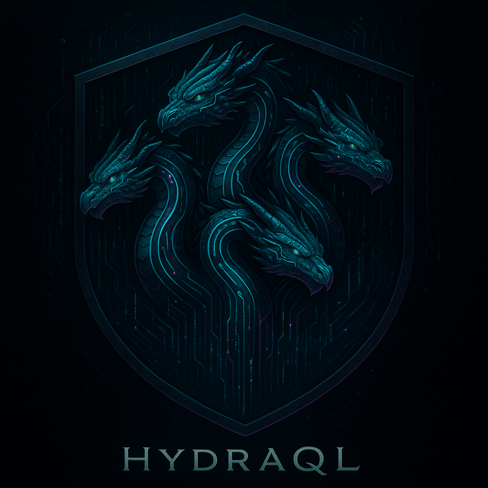

# HydraQL

[](https://github.com/gbiagomba/hydraql/actions/workflows/ci-release.yml)

## Background / Lore
**HydraQL** is a parallel CodeQL scanning engine — many-headed like the Hydra 🐍.  
It runs CodeQL queries against multiple databases, in parallel, across multiple languages, and merges results into CSV, JSON, or SARIF outputs.

Born from the need to scale CodeQL analysis across large, multi-language codebases, HydraQL aims to be fast, flexible, and mythic.

---

## Table of Contents
- [Features](#features)
- [Installation](#installation)
  - [go install](#go-install-recommended)
  - [Pre-built Binary](#pre-built-binary)
  - [Build from Source](#build-from-source)
  - [Makefile Run Targets](#makefile-run-targets)
  - [Docker](#docker)
  - [Python Legacy](#python-legacy)
- [Usage](#usage)
  - [Database Layouts](#database-layouts)
  - [Flag Reference](#flag-reference)
  - [Output](#output)
  - [Examples](#examples)
- [CI / Release](#ci--release)
- [Contributing](#contributing)
- [License](#license)

---

## Features
- 🦫 **Single Go binary** — no runtime dependencies; one file per platform
- 🔥 Parallel query execution (`-t 8` / `--threads 8`)
- 📦 Optional `codeql pack install` (`-P` / `--pack-install`)
- 🧩 Multiple query directories (comma-separated or repeated `-q`)
- 🐍 Language aliasing (TypeScript→JavaScript, Kotlin→Java, Go→Go)
- 🏗️ **One-stop build and scan** (`-b` / `--build-root`): creates a database cluster per project source dir, finalizes it, then scans it. No separate `codeql database create` / `finalize` loops
- 🔨 **Build commands for compiled languages** (`--build-command`, `--build-mode`): passthrough to CodeQL's `--command`, so Java/Kotlin, C/C++, C#, and Swift build as part of the same run
- 🔗 **Symlink resolution** (on by default): a symlinked source root is resolved to its real target before CodeQL sees it, so extraction stays scoped to the linked subtree instead of widening to the link targets' common ancestor
- 🗂️ **Multi-database scanning**: one run fans out across every project under `--db-root`, and findings carry the project they came from
- 🛡️ Database preflight: presence, finalization, structure, and emptiness checks
- 🔒 IMB cache lock detection and auto-removal (`-u` / `--unlock-cache`)
- 🔧 DB automation: auto-finalize (`-F`) and auto-init (`-i`) with `--source-root`
- 🎨 Fancy colored output and ASCII summary chart (`-f` / `--fancy`)
- 🔍 Severity filtering with strict or loose matching (`-s HIGH`)
- 📊 Outputs in CSV, JSON, or SARIF (`-o sarif`)
- ⏱️ Per-query timeout (`-T 600`) with real-time progress ticker — never hang on slow suites
- 🚀 GitHub Actions CI: cross-compile, release, and Docker publish on tag

---

## Installation

### `go install` (recommended)

**Prerequisites:** Go 1.26+, CodeQL CLI in `$PATH`

```bash
go install github.com/gbiagomba/hydraql/v2/cmd/hydraql@latest
```

The binary lands in `$GOPATH/bin` (usually `$HOME/go/bin`). Make sure that directory is in your `$PATH`:

```bash
# Add to ~/.zshrc or ~/.bashrc if not already present
export PATH="$HOME/go/bin:$PATH"

# Verify
hydraql --version
```

### Pre-built Binary

Download the binary for your platform from [Releases](https://github.com/gbiagomba/hydraql/releases):

| Platform       | Binary                         |
|----------------|--------------------------------|
| macOS (Apple)  | `hydraql-darwin-arm64`         |
| macOS (Intel)  | `hydraql-darwin-amd64`         |
| Linux x86-64   | `hydraql-linux-amd64`          |
| Linux ARM64    | `hydraql-linux-arm64`          |
| Windows x86-64 | `hydraql-windows-amd64.exe`    |
| Windows ARM64  | `hydraql-windows-arm64.exe`    |

```bash
# macOS / Linux — download, make executable, move to PATH
curl -L https://github.com/gbiagomba/HydraQL/releases/latest/download/hydraql-darwin-arm64 \
  -o /usr/local/bin/hydraql && chmod +x /usr/local/bin/hydraql

# Verify
hydraql --version
```

### Build from Source

```bash
git clone https://github.com/gbiagomba/hydraql.git
cd hydraql

make build          # native binary → ./hydraql
make build-all      # all 6 platform binaries → dist/
make go-test        # run tests
make go-vet         # run go vet
make go-fmt         # fail if anything is unformatted
```

### Makefile Run Targets

`make help` lists everything. The run targets wrap the binary so the common
flags become variables:

```bash
# Scan databases that already exist under DB_ROOT
make scan DB_ROOT=./cqlDB LANGS=javascript,typescript QUERY_DIRS=~/Git/codeql

# Build a database per project, then scan them all
make all BUILD_ROOT=~/Projects/App/src DB_ROOT=./cqlDB \
  LANGS=javascript,typescript FORMAT=sarif

# Build only, so the scan can run separately later
make build-db BUILD_ROOT=~/Projects/App/src DB_ROOT=./cqlDB LANGS=javascript

# Shorthands
make scan-sarif          # FORMAT=sarif
make scan-json           # FORMAT=json
make scan-high           # SEVERITY=HIGH
```

Build-phase variables: `BUILD_ROOT`, `SOURCE_DIRS`, `DB_PREFIX`, `EXCLUDE`,
`REBUILD_DB=1`, `RESOLVE_SYMLINKS=0`, `BUILD_COMMAND`, `BUILD_MODE`,
`BUILD_TIMEOUT`, `BUILD_THREADS`.
Scan variables: `DB_ROOT`, `LANGS`, `QUERY_DIRS`, `FORMAT`, `THREADS`,
`SEVERITY`, `STRICT`, `FANCY`, `VERBOSE`, `DRY_RUN`, `ALLOW_MISSING`,
`SUITE_ONLY`, `PACK_INSTALL`, `UNLOCK_CACHE`, `CHECK_LOCK_PROC`,
`KILL_LOCK_PROC`, `AUTO_FINALIZE_DB`, `AUTO_INIT_DB`, `SOURCE_ROOT`,
`FORCE_UNREADY`, `QUERY_TIMEOUT`, `NO_TIMEOUT`.

`make run` and its variants still drive the legacy Python script.

### Docker

```bash
# Build image (compiles Go binary inside Docker)
docker build -t hydraql:latest .

# With a specific CodeQL CLI version
docker build --build-arg CODEQL_VERSION=2.25.6 -t hydraql:latest .

# Run
docker run --rm \
  -v "$PWD/cqlDB:/app/cqlDB" \
  -v "$HOME/Git/codeql:/app/queries:ro" \
  hydraql:latest \
  --db-root /app/cqlDB \
  --langs "javascript,typescript,python,java" \
  --query-dir /app/queries \
  --output-format sarif \
  --fancy
```

### Python (legacy)

The original Python implementation lives in `legacy/` and remains functional at the v1.8.0 feature level.
It has none of the v2.2.0 build, symlink, or multi-database features, and it still carries the
`--format sarif` / `--format json` defect fixed in the Go edition, so only `--output-format csv`
produces results there.

```bash
# Prerequisites: Python 3.7+, CodeQL CLI in PATH
python3 legacy/hydraql.py --help

# Or via Makefile
make run
```

---

## Usage

### Database Layouts

HydraQL recognizes three layouts under `--db-root` and picks whichever one it finds:

| Layout | Shape | Project column |
|--------|-------|----------------|
| Flat | `<db-root>/<lang>/` | empty |
| Single database | `<db-root>/codeql-database.yml` | the db-root's own name |
| Per project | `<db-root>/<project>/<lang>/` | the project directory name |

The per-project layout is what `--build-root` produces, and it is also CodeQL's
own `--db-cluster` shape, so a cluster built by hand drops straight in:

```
cqlDB/
├── accessibility-checker/
│   └── javascript/
└── pdf-export-core/
    └── javascript/
```

Projects may differ in language. A project with no database for one of the
requested languages is skipped quietly rather than failing the run.

#### Build phase

`--build-root <dir>` treats every child directory of `<dir>` as a project and,
for each one, runs `codeql database create --db-cluster` followed by a finalize
pass, then scans the result. `--source-dir` names project directories
explicitly instead and can be combined with `--build-root`.

Three things the equivalent shell loop gets wrong and this does not:

1. **Symlinks are resolved first.** Pointing CodeQL at a directory of symlinks
   makes it follow them and extract their common ancestor. A tree of four
   symlinks into a monorepo produced one 10M-LOC database; resolving each link
   first produced four databases of 3k to 16k LOC. Disable with
   `--no-resolve-symlinks`.
2. **Languages are deduplicated.** CodeQL has no separate `typescript`
   extractor, so `--langs javascript,typescript` is collapsed to
   `--language=javascript` rather than extracting the same files twice.
3. **Existing databases are not rebuilt.** A directory that is already a usable
   database is finalized and reused; pass `--rebuild-db` to force
   `codeql database create --overwrite`. Previously built database directories
   under `--build-root` are never mistaken for source projects.

Directories that are never source projects (`node_modules`, `dist`, `build`,
`reports`, and similar) are skipped by default. Pass `--exclude` to replace that
list, or `--exclude ""` to disable it.

#### Compiled languages

JavaScript/TypeScript, Python, and Ruby extract without being built. Java and
Kotlin, C/C++, C#, Swift, and Go generally need the compiler to run, which is
what `--build-command` is for; it maps straight onto CodeQL's `--command`:

```bash
hydraql --source-dir . -d . --db-prefix cqlDB_ \
  -l "javascript,typescript,python,kotlin,cpp,swift" \
  --build-command "./build.sh" --rebuild-db --build-only
```

That produces exactly one cluster, `./cqlDB_<dirname>/<lang>/`, and runs:

```
codeql database create cqlDB_<dirname> --db-cluster \
  --language=javascript,python,java,cpp,swift \
  --source-root=<resolved dir> --command=./build.sh --overwrite
```

Note what HydraQL normalized: `typescript` folded into `javascript` and
`kotlin` into `java`, matching CodeQL's actual extractor set. In a mixed
cluster the command runs once under tracing for the compiled languages, while
the interpreted ones extract from source regardless.

Repeat `--build-command` for a multi-step build; the commands are forwarded in
order. `--build-mode` (`none`, `autobuild`, `manual`) is also available, though
supplying a command already implies `manual`, so the two are rarely combined.
`--build-mode none` together with `--build-command` is rejected outright, since
that mode never builds the source root.

**The command's working directory is the resolved source root.** Because
symlinks are resolved first, a `build.sh` sitting next to a *symlink* is not
next to the directory CodeQL ends up in. Reference the script by a path that
exists inside the real tree, or pass `--no-resolve-symlinks`.

### Flag Reference

All flags support both a short form (`-X`) and the traditional long form (`--flag-name`).

| Short | Long                    | Default   | Description                                            |
|-------|-------------------------|-----------|--------------------------------------------------------|
| `-d`  | `--db-root`             | `cqlDB`   | Root of CodeQL databases (see [Database Layouts](#database-layouts)) |
| `-l`  | `--langs`               | `java,javascript,typescript,python` | Comma-separated languages to scan |
| `-q`  | `--query-dir`           | `~/Git/codeql` | Query directory (repeat or comma-separate for multiple) |
| `-t`  | `--threads`             | `6`       | Parallel worker count (alias: `--parallel`)            |
| `-o`  | `--output-format`       | `csv`     | Output format: `csv`, `json`, `sarif`                  |
| `-s`  | `--severity`            | _(none)_  | Filter findings by severity (e.g. `HIGH`, `CRITICAL`)  |
| `-S`  | `--strict-severity`     | `false`   | Exact severity match (no loose mapping)                |
| `-f`  | `--fancy`               | `false`   | Colored output + ASCII chart                           |
| `-v`  | `--verbose`             | `false`   | Verbose command logging and error details              |
| `-n`  | `--dry-run`             | `false`   | Print commands without executing                       |
| `-P`  | `--pack-install`        | `false`   | Run `codeql pack install` before scanning              |
| `-m`  | `--allow-missing-db`    | `false`   | Continue if some DBs are missing or unfinalized        |
| `-x`  | `--suite-only`          | `false`   | Run only `.qls` suites; skip individual `.ql` files    |
| `-u`  | `--unlock-cache`        | `false`   | Delete stale IMB cache `.lock` files                   |
| `-c`  | `--check-lock-process`  | `false`   | Inspect PID inside any cache `.lock` file              |
| `-k`  | `--kill-lock-process`   | `false`   | **DANGER:** `kill -9` the PID found in the cache lock  |
| `-F`  | `--auto-finalize-db`    | `false`   | Automatically finalize unfinalized DBs (idempotent)    |
| `-i`  | `--auto-init-db`        | `false`   | Create missing DBs (requires `--source-root`)          |
| `-r`  | `--source-root`         | _(none)_  | Source root path for `--auto-init-db`                  |
| `-R`  | `--force-scan-unready`  | `false`   | Scan DBs that appear empty or unusable                 |
| `-b`  | `--build-root`          | _(none)_  | Parent directory of project source dirs; build a DB per child, then scan |
|       | `--source-dir`          | _(none)_  | Explicit project source dir (repeat or comma-separate) |
|       | `--db-prefix`           | `""`      | Prefix for each project's DB directory name (e.g. `cqlDB_eac-`) |
|       | `--exclude`             | see above | Glob of `--build-root` child names to skip; `""` disables |
|       | `--build-only`          | `false`   | Build and finalize databases, then exit without analyzing |
|       | `--rebuild-db`          | `false`   | Force rebuild of existing DBs (`database create --overwrite`) |
|       | `--no-resolve-symlinks` | `false`   | Do not resolve symlinked source roots before CodeQL sees them |
|       | `--build-command`       | _(none)_  | Build command for compiled languages, as codeql `--command` (repeat for several) |
|       | `--build-mode`          | _(none)_  | CodeQL build mode: `none`, `autobuild`, or `manual`    |
|       | `--build-timeout`       | `0`       | Per-database creation timeout in seconds (`0` = none)  |
| `-B`  | `--build-threads`       | `1`       | Concurrent database builds                             |
| `-T`  | `--query-timeout`       | `600`     | Per-query timeout in seconds (`0` = no timeout)        |
| `-N`  | `--no-timeout`          | `false`   | Disable per-query timeout entirely                     |
| `-V`  | `--version`             | —         | Print version and exit                                 |

### Output

Results land in `HydraQL_output-<timestamp>.<csv|json|sarif>`, and every finding
is tagged with the project whose database produced it:

| Format | Project attribution |
|--------|---------------------|
| `csv`  | leading `Project` column |
| `json` | `project` key per record, alongside flattened `ruleId`, `severity`, `messageText`, `path`, and `startLine` |
| `sarif` | one run per query per project, with `automationDetails.id` and `properties.hydraql.project` set to the project name |

CodeQL accepts neither `sarif` nor `json` as a `--format` value, so HydraQL
requests `sarif-latest` for both and derives the JSON records from it.

### Examples

```bash
# One-stop shop: build a database per project, then scan them all.
# Each source dir is resolved through its symlinks before CodeQL sees it.
./hydraql \
  --build-root ~/Projects/MyMonorepoLinks/src \
  -d ./cqlDB \
  -l "javascript,typescript" \
  -q ~/Git/codeql \
  -o sarif -F -u -f

# Build the databases and stop, so the scan can run separately later
./hydraql --build-root ~/Projects/MyMonorepoLinks/src -d ./cqlDB -l javascript --build-only -f

# Two named projects, naming the DB dirs cqlDB_eac-<project>
./hydraql \
  --source-dir ~/Projects/App/src/feature-a,~/Projects/App/src/feature-b \
  -d ./cqlDB --db-prefix cqlDB_eac- -l javascript -q ~/Git/codeql -f

# Rebuild from scratch after the source trees moved
./hydraql --build-root ~/Projects/App/src -d ./cqlDB -l javascript --rebuild-db -f

# See the build plan, including every resolved source root, without running CodeQL
./hydraql --build-root ~/Projects/App/src -d ./cqlDB -l javascript,typescript -n -v

# Full scan — real-world AEM codebase (long flags)
./hydraql \
  --db-root ./cqlDB_AEM \
  --langs "java,javascript,typescript,python,cpp,go,kotlin,csharp" \
  --query-dir "~/Git/codeql,~/Git/exiv2,~/Git/CodeQL-Community-Packs" \
  --auto-finalize-db --allow-missing-db \
  --unlock-cache --check-lock-process \
  --fancy --verbose

# Same command with short flags
./hydraql \
  -d ./cqlDB_AEM \
  -l "java,javascript,typescript,python,cpp,go,kotlin,csharp" \
  -q "~/Git/codeql,~/Git/exiv2,~/Git/CodeQL-Community-Packs" \
  -F -m -u -c -f -v

# SARIF output, 8 parallel workers
./hydraql -d ./cqlDB -l "java,javascript" -q ~/Git/codeql -o sarif -t 8 -f

# Filter to HIGH and CRITICAL findings only
./hydraql -d ./cqlDB -l "java" -q ~/Git/codeql -s HIGH -f

# Strict severity match (no loose mapping)
./hydraql -d ./cqlDB -l "java" -q ~/Git/codeql -s CRITICAL -S

# Large suite — extend timeout to 30 minutes
./hydraql -d ./cqlDB -l "javascript" -q ~/Git/codeql -T 1800 -f

# Disable timeout for known-slow suites
./hydraql -d ./cqlDB -l "javascript" -q ~/Git/codeql -N -f

# Dry run — see what would execute without running CodeQL
./hydraql -d ./cqlDB -l "java" -q ~/Git/codeql -n -v

# Docker run
docker run --rm \
  -v "$PWD/cqlDB:/app/cqlDB" \
  -v "$HOME/Git/codeql:/app/queries:ro" \
  hydraql:latest \
  -d /app/cqlDB -l "javascript,java" -q /app/queries -o sarif -f
```

---

## CI / Release

On every push, GitHub Actions runs:
- `go vet`, `go build`, `go test` on 5 runners: linux/amd64, linux/arm64, darwin/arm64, windows/amd64, windows/arm64

On a `v*` tag push:
- Cross-compiles all 6 binaries via `make build-all`
- Generates SHA-256 checksums for each binary
- Publishes a GitHub Release with binaries and checksums
- Builds and pushes a Docker image (`linux/amd64`) to Docker Hub

To publish a release:
```bash
git tag -a v2.3.0 -m "Release v2.3.0"
git push origin v2.3.0
```

Docker Hub publishing requires `DOCKER_USERNAME` and `DOCKER_PASSWORD` secrets set in the repository settings.

---

## Contributing

PRs are welcome! Ideas include:
- Additional language support and aliases
- Plugin system for custom report exporters
- SARIF upload to GitHub Code Scanning via the existing CI workflow

---

## License

This project is licensed under the GPL-3.0 License.  
See the [LICENSE](LICENSE) file for details.
